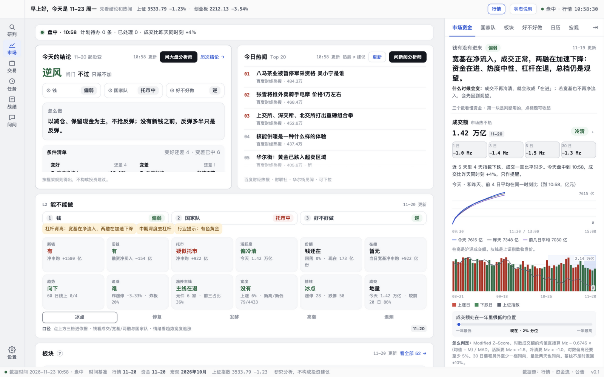
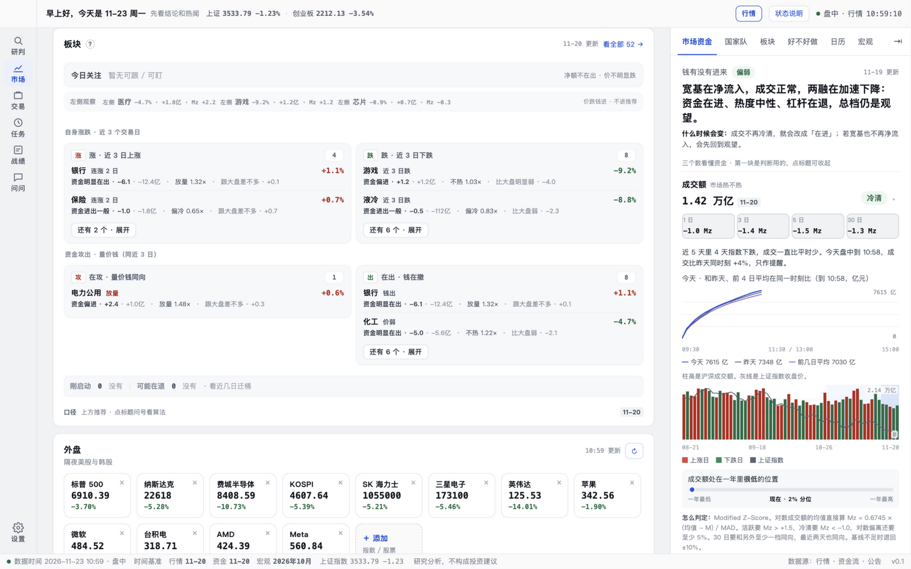
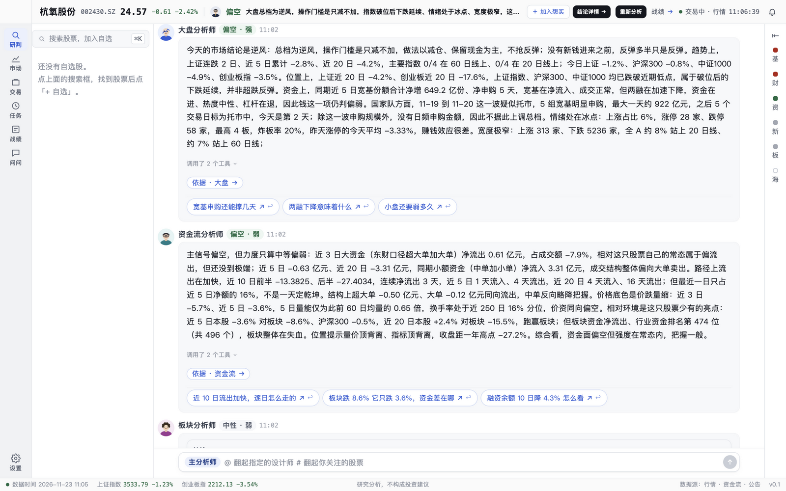
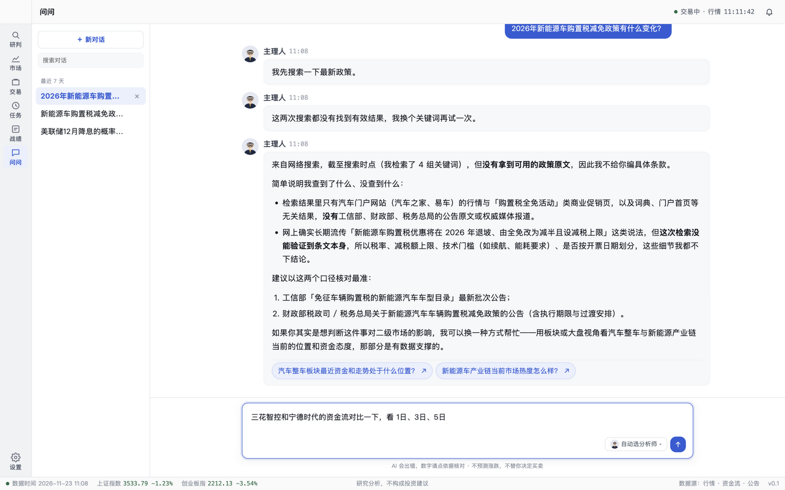
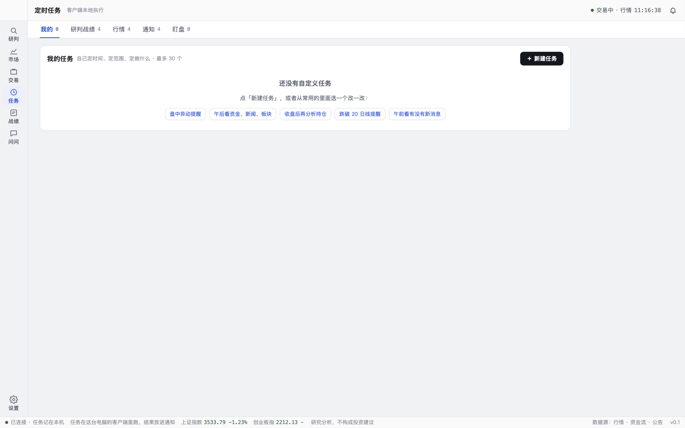
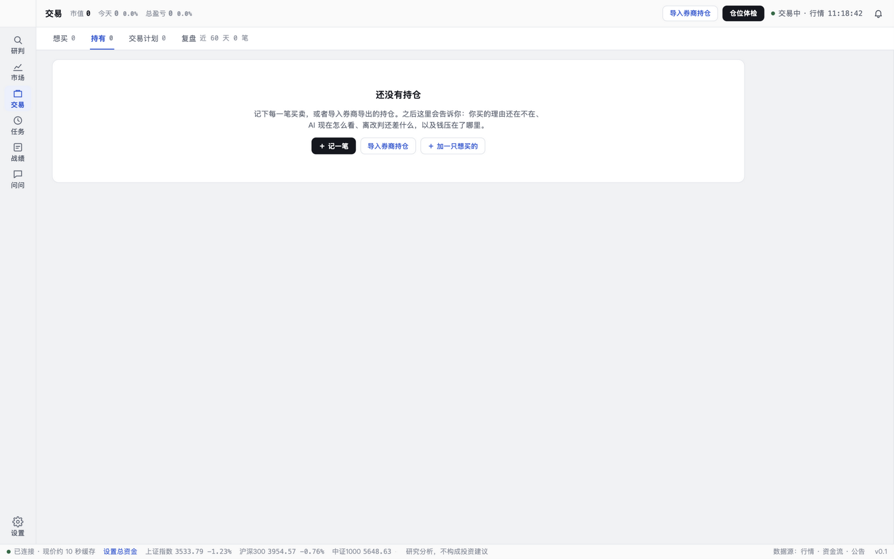

# 牛宝使用案例

> 以下截图均为真实运行画面（2026-11-20 / 11-23 盘中与盘后，真实行情数据）。
> 图片目录：`docs/screenshots/`

## 1. 市场：今天好不好做，一眼定调

打开默认落在**今天的结论**：逆风大字 + 闸门「不过 · 只减不加」；三格信号（钱·偏弱 / 国家队·托市中 / 情绪·冰点）各带一句论据；右侧条件清单写明**变好还差 6 格、变差已中 4 格**——距离改判有多远，格子看得见。

往下是「能不能做」的证据宫格（钱 / 国家队 / 情绪三路 12 指标 + 冰点→退潮阶段轴）、指数、市场资金、大盘结构、板块、个股资金流、宏观、日历、外盘。

板块模块：五桶分组（左侧价跌钱进 / 潜伏 / 派发 / 退潮 / 观望）+ 在攻 / 在出双榜。「钱出得最狠」直接点名（黄金 −12.9 亿 · −3.6σ）。

## 2. 研判（诊断）：九位分析师的晨会

点「开始研判」，主分析师开场点将，六位维度分析师**依次取数发言**——大盘、资金流、板块、新闻、财报、基本面，各自带可核对依据（每句结论旁的「依据」按钮点开就是当时取到的数）。发言结论分级（偏空 · 弱 / 中性 / 偏多），弱信号直说「凑不齐」。

六维说完，**看多 / 看空各辩一轮**（论据须通过对方核对），最后主分析师裁决：方向、得分、采纳了谁、否了谁、「如果我错了」的退出条件，以及持有 / 观望两类人的条件式提醒。

## 3. 问问：一个问题，编排整条链路

问问页的会话主理人负责编排：个股问题请对应分析师；**非个股问题（政策、宏观、事件）先走网络搜索**——截图里问购置税政策，搜不到权威原文时如实说「不给你编具体条款」，只给可查证的部分并注明信息来源与截止时间。

## 4. 定时任务：人不在，它也在

托盘常驻，关窗不停。系统任务（研判战绩 / 行情 / 通知 / 盯盘）+ 自定义三种模式：**定时分析**（到点重跑结论，记成预测）、**定时提问**（按你写的问题逐只问）、**条件扫描**（破线、资金连出才通知，可不跑模型）。常用模板一键改：盘中异动提醒、午后看资金、收盘后复析持仓、跌破 20 日线提醒。

## 5. 交易：研判结论落进持仓闭环

研判的结论直接进**想买 / 持有 / 交易计划 / 复盘**：想买记下理由和失效条件，之后每天核对这些前提还在不在；持有对照买入逻辑；右侧个股面板是成本、AI 观点、板块与操作提醒。5 / 20 个交易日后，战绩页结算方向预测。

---

*所有输出均为研究分析，不构成投资建议；不预测涨跌，不接交易通道。*
